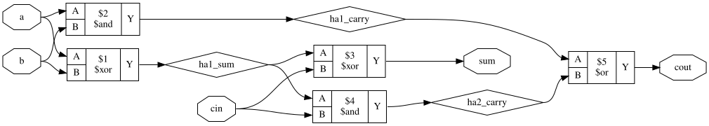

# Seeing it come back as a schematic

**Question this page answers:** *I turned a drawing into text. Can I get the drawing back —
and will it still behave?*

Yes. In a browser tab, in about thirty seconds, with no account and nothing installed.

This is the best moment DD102 has to offer, so it is worth saying plainly what is about to
happen. In DD101 you drew a circuit and clicked its inputs to watch it work. On the last
three pages you typed that drawing out as text. Now you are going to hand the text to a
real synthesizer, get a **clickable schematic** back, click *its* inputs, and find your
eight rows waiting for you.

If the picture that comes back is your picture, then nothing was lost in the transcription
— and that is the only proof that matters that a drawing and a language can be the same
thing.

## Open it

**<https://digitaljs.tilk.eu/>**

It is a demonstration app for **DigitalJS**, a simulator by Marek Materzok at the
University of Wrocław, and it runs **Yosys** — the same synthesizer you have been using —
compiled to WebAssembly and running inside your browser. Nothing is uploaded. There is
nothing to sign up for.

The page opens split down the middle: the left half is a panel with two tabs, **Setup** and
**I/O**, and the right half is empty white space where the circuit will appear. Across the
top is a toolbar whose left-most control is a blue button with a ▶ triangle and the word
**Run**. Hover it and the tooltip says *Synthesize and simulate!* Everything else in that
toolbar — the ⏸ ▶ ⏩ → ⇥ time controls, the ⏱ tick counter, and the 📁 💾 🔗 buttons — is
greyed out until you have run something once.

> On a narrow screen the two halves stack, and two buttons appear at the bottom right —
> **`</>` Code** and **Circuit** — to switch between them. Unlike CircuitVerse, this page
> does work on a phone. It is still miserable on a phone. Use a laptop.

## Paste your adder in

1. On the **Setup** tab, find the row with a text box that says `file name`, a small grey
   dropdown showing **`.sv`**, and a blue **Create file** button.
2. Type `full_adder` in the box. Leave the dropdown on `.sv` — its full label is
   *".sv (SystemVerilog, Yosys native)"*, which is exactly what you have written.
3. Press **Create file**. A third tab appears beside *Setup* and *I/O*, containing an
   editor.
4. Paste the whole of your `full_adder.sv` into it. All 21 lines, comments and all.
5. Press **Run**.

Leave every checkbox alone. The defaults are the ones this page is written against:
*Simplify diagram* ticked, *Optimize in Yosys* unticked, *Convert to logic gates* unticked,
*Synthesis mode* on *WebAssembly (faster and local)*, and *Lint source code using Verilator*
ticked. (That last one runs Verilator over your file looking for common mistakes. Your
adder passes it silently — if it did not, you would get a message rather than a diagram.)

## What comes back

**Five gates.** Two Xor, two And, one Or — arranged left to right, with the two Xors on the
path to `sum` and the And/And/Or on the path to `cout`.

That is your drawing. Not something like it: the same five gates, in the same two chains,
because those five gates are the five `assign` lines you typed, which are the five wires
you drew.

Around them:

- **Three boxes on the left, labelled `a`, `b` and `cin`.** These are *buttons*. Click one
  and it flips between `0` and `1`, exactly like an Input element in CircuitVerse.
- **Two boxes on the right, labelled `sum` and `cout`.** These are *lamps*. They show what
  your circuit is producing, right now.
- **Wires that change colour.** A wire carrying `1` turns **green**; a wire carrying `0`
  turns a **salmon red**; a wire nobody has driven yet stays **grey**. Hover over any wire
  and a small box pops up with its current value — including the wires in the middle, the
  ones you named `ha1_sum` and `ha1_carry`.

> **The reason your ports became buttons and lamps** is a rule worth knowing, because it
> will surprise you later: a 1-bit top-level **input** is drawn as a clickable button, a
> wider one as a number-entry box; a 1-bit **output** becomes a lamp, a wider one a number
> display. And an input named exactly `clk` or `clock` is not drawn as a button at all — it
> silently becomes a **clock source** that ticks on its own. That is helpful right up until
> the day you name something `clock` and cannot work out why it will not stop changing.

## Now do the thing

Click `a`, `b` and `cin` through all eight combinations, in the order on your worksheet,
and read the two lamps each time.

| a | b | cin | cout | sum |
|---|---|-----|------|-----|
| 0 | 0 | 0 | 0 | 0 |
| 0 | 0 | 1 | 0 | 1 |
| 0 | 1 | 0 | 0 | 1 |
| 0 | 1 | 1 | 1 | 0 |
| 1 | 0 | 0 | 0 | 1 |
| 1 | 0 | 1 | 1 | 0 |
| 1 | 1 | 0 | 1 | 0 |
| 1 | 1 | 1 | 1 | 1 |

Eight for eight. It is your table, from DD101, off a circuit you did not draw, generated
from text you typed, by a tool that has never seen your paper.

**Why an engineer cares.** You have now watched one design in four forms — a drawing, a
truth table, a text file, and a machine-generated schematic — and all four agree. That is
what "the design" means: not the file and not the picture, but the behaviour they all
describe. Every tool for the rest of your career is a translation between two of those
forms, and the reason the industry can trust a hundred such translations in a row is that
each one is checkable in exactly the way you just checked this one.

## Reproduce the same picture in the workbench

The browser is not doing anything magic, and you can prove that too. This is the exact
command list DigitalJS runs — copied out of its converter's source, with every checkbox at
its default — and it ships as
[`scripts/digitaljs.ys`](https://github.com/uoftasic/dd102/blob/main/labs/guide-examples/scripts/digitaljs.ys):

```
read_verilog -sv src/full_adder.sv
setattr -mod -unset top
hierarchy -auto-top
proc
opt_clean
memory -nomap
wreduce -memx
opt_clean
stat
show -format svg -prefix results/full_adder_rtl -notitle
```

```bash
cd labs/guide-examples
make picture
```

```
        5 cells
        2   $and
        1   $or
        2   $xor
wrote results/full_adder_rtl.svg -- open it in a browser
```

**Two `$and`, one `$or`, two `$xor`.** The same five, counted by the same Yosys, printed
as a number instead of a picture. The SVG it writes alongside them looks like this:



Note the labels on the wires in the middle. `ha1_sum`, `ha1_carry`, `ha2_carry` — the names
*you* invented, on page one of this course, surviving all the way through a synthesizer and
out the other side into a diagram. Naming your wires well is not a style preference; it is
the only thing that makes the output of these tools readable.

## Four things that will otherwise confuse you

**1. The `case` version does not come back as gates. It comes back as one box.**

Paste `full_adder_table.sv` — the `always_comb` + `case` version — press Run, and you get
a single rectangle labelled **Memory**, with an address input, and no gates at all. You
have not done anything wrong, and the circuit is not different. Yosys recognised eight
rows indexed by a 3-bit value as a lookup table and drew it as one, because at this stage
of the flow it has not been asked to build anything out of gates yet.

The same file, sent all the way to a real cell library, is still **2 cells and 33.7824 µm²**
— you measured that on the last page.

> **The reflex:** a schematic viewer shows you **how you wrote it**. Only a synthesizer
> with a cell library tells you **what it costs**. Never quote one when you were asked the
> other.

**2. Do not carry a cell count out of the browser.**

DigitalJS builds its Yosys from a package that is not version-pinned; the copy running in
your tab today may be a different Yosys from the one in the workbench, and it can change
under you between one week and the next. Worse, it has **no cell library at all** — a
browser cannot reach `sky130_fd_sc_hd__tt_025C_1v80.lib` — so it stops at generic gates
with names like `$and` and can never print an area.

Your adder is **five generic gates** in the browser and **two sky130 cells, 33.7824 µm²**
in the workbench. Both numbers are correct. They are answers to different questions, and
DD103 is the course about the second one.

**3. The checkboxes that look like "show me the real chip" do not.**

Under *Circuit synthesis* there are two tempting options. Ticking **Convert to logic gates**
renames your five gates from `$and`/`$or`/`$xor` to `$_AND_`/`$_OR_`/`$_XOR_` — the same
five gates, in Yosys's internal spelling. Additionally ticking **Map into subset of gates**
with its default set gives you something genuinely fun:

```
        5 cells
        3   $_NAND_
        2   $_XOR_
```

**Three NANDs and two XORs.** Your Or and both your Ands have been rebuilt out of NAND,
automatically, by a tool, for the same reason you built them out of NAND by hand in
[DD101 Lab 02](https://uoftasic.com/dd101/#/labs/lab-02-gates-from-one-gate). Worth two
minutes of your time.

It is still not an area, and it is still not what a factory would build. Untick them again
before you compare anything to your drawing.

**4. Multi-file designs need a second tab.**

`full_adder_hier.sv` will not run on its own, because it instantiates `half_adder` and
DigitalJS has never heard of it. Press **Create file** a second time, name it
`half_adder`, paste that module in, and press Run. Both files are compiled together and
you get the hierarchical view: `half_adder` is drawn as a single box, twice. Hover one of
those boxes and a small **🔍** appears above it; click that and the view descends into the
box to show the Xor and the And inside. It is the same gesture as opening a subcircuit in
CircuitVerse, and it is the picture of what page two of this guide called *the walls*.

(The *Additional SystemVerilog files:* file-picker further down the Setup tab does the same
job from files on your disk.)

## Save what you are looking at

Once a circuit is on screen, the three greyed-out buttons in the toolbar wake up:

- **📁** *Load from file* and **💾** *Save to file* — save and reload the whole circuit as
  JSON.
- **🔗** *Get link* — turns what you are looking at into a URL.

That last one is the single most useful thing on this page for an asynchronous course.
When you want help in the [Discord](https://discord.gg/hrJnP5UsGz), do not post a
screenshot of a schematic. Post the link. Whoever answers can click your inputs themselves.

## What you have

- Your text, turned back into a schematic by a real synthesizer, in a browser
- Eight rows clicked out by hand on a circuit you did not draw, agreeing with the eight
  rows you wrote by hand in DD101
- The rule that separates a viewer from a synthesizer: **how you wrote it** versus **what
  it costs**
- The one number that follows this adder around: **33.7824 µm²**

[Lab 02 — Prove it](labs/lab-02-prove-it-overview.md) is where you do this on a design whose answer
you have not already seen.

Next: [Eight rows and no opinions](guide/eight-rows-and-no-opinions.md), where you stop
clicking inputs by hand and let a testbench click them for you — because eight rows is
small enough to click, and the four-bit adder at the end of this course has 512.
