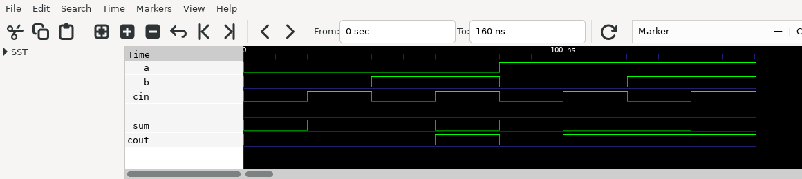
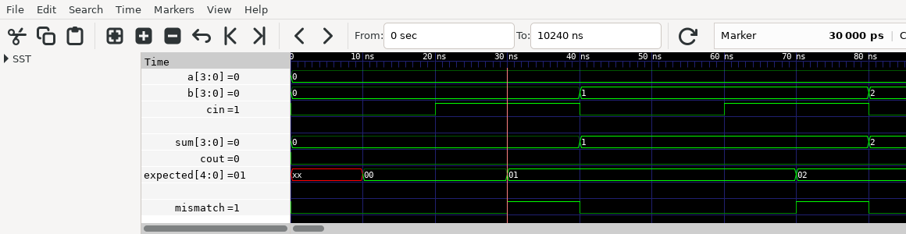
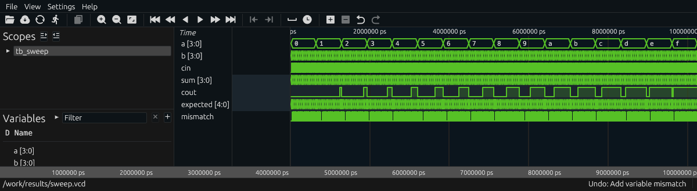

# Two lines make the waveform appear

**Question this page answers:** *Everybody who does this shows me pictures of squiggly lines.
Where is mine?*

You already have one. When you ran the 512-vector sweep on the
[previous page](guide/eight-rows-and-no-opinions.md), the very first line of output was:

```
VCD info: dumpfile sweep.vcd opened for output.
```

and it left a **57,207-byte** file sitting next to you that you have not looked at. This page
is about opening it.

## The two lines

They are in the testbench, not in your design. Your design never knows it is being watched.

```systemverilog
$dumpfile("sweep.vcd");     // what to call the file
$dumpvars(0, tb_sweep);     // what to put in it
```

**`$dumpfile`** names the output file. That is all it does.

**`$dumpvars`** picks the signals. The two arguments are *how deep* and *starting where*. The
`0` means **"this module and everything inside it, all the way down"** — so you get the
testbench's own wires *and* everything inside `dut`, and inside the four `full_adder`s inside
that. A `1` would mean "this module only, do not go inside". Zero is the one you want while
you are learning; it is also the one that makes big files.

Delete either line and the simulation still runs, still prints, still passes or fails — and
produces no waveform at all. **A missing waveform is almost never a broken design.** It is
almost always these two lines missing, or the viewer never being told which signals to show.

## What is actually in the file

A VCD (Value Change Dump) is a plain text file, and it is worth looking inside exactly once so
it stops being magic. Here are the first fifteen lines of `eight.vcd`, the small one from the
8-row run — **1,147 bytes, 113 lines** in total:

```
$date
	Wed Aug 26 04:37:14 2026
$end
$version
	Icarus Verilog
$end
$timescale
	1ps
$end
$scope module tb_eight_rows $end
$var wire 1 ! sum $end
$var wire 1 " cout $end
$var reg 1 # a $end
$var reg 1 $ b $end
$var reg 1 % cin $end
```

(Your `$date` line will say when *you* ran it, and Icarus writes the header's `$timescale` as
`1ps` because that is the precision your testbench asked for with `` `timescale 1ns/1ps ``.)

Then, after the header, the actual data:

```
#0
$dumpvars
...
0%
0$
0#
0"
0!
$end
#10000
b1 (
#20000
1!
1%
```

That is the whole format. Each signal gets a **one-character nickname** (`!`, `"`, `#`, `$`,
`%`) so the file does not repeat long names ten thousand times. `#20000` is a timestamp — 20,000
picoseconds, i.e. 20 ns. `1!` means "the signal called `!` — that is `sum` — became 1". Nothing
is recorded when nothing changes, which is why a file covering 10,240 ns of simulation is only
57 KB.

You are never going to read one of these by hand. But now you know that when a viewer shows you
nothing, the question "is the data in the file?" has a boring, checkable answer.

## Path A — the browser

This is the zero-install route and it is genuinely the fastest way to show somebody else what
you are seeing.

1. Open **<https://www.edaplayground.com/>** and log in (the one Google account this track asks
   for — see [Getting started](guide/getting-started.md)).
2. Paste
   [`src/full_adder.sv`](https://github.com/uoftasic/dd102/blob/main/labs/guide-examples-proving-it/src/full_adder.sv)
   into the **`design.sv`** tab and
   [`src/tb_eight_rows.sv`](https://github.com/uoftasic/dd102/blob/main/labs/guide-examples-proving-it/src/tb_eight_rows.sv)
   into the **`testbench.sv`** tab. The file names are fixed; your module names are not, and
   `full_adder` is still `full_adder`.
3. In the left sidebar, set the simulator to **Icarus Verilog 12.0**.
4. Tick **Open EPWave after run**.
5. Click **Run**.

EDA Playground's own documentation is exact about the last two steps, and about a trap that
otherwise costs people an afternoon:

> *"Make sure your code contains appropriate function calls to create a `*.vcd` file… Select a
> simulator and check the **Open EPWave after run** checkbox… Click **Run**. After the run
> completes, the resulting waves will load in a new EPWave window. **(Pop-ups must be
> enabled.)**"*

**Read "Pop-ups must be enabled" twice.** The waveform opens in a *new browser window*, so a
browser that blocks it — silently, as most of them do — leaves you looking at a successful run
with no picture and no error message of any kind. There is nothing in the EDA Playground output
that will tell you this happened.

### The one thing on this page that does not survive the trip

The browser runs **Icarus Verilog 12.0**. Your workbench runs **14.0**. For everything DD102
asks you to write, this makes no difference — every testbench in
[`labs/guide-examples-proving-it/`](https://github.com/uoftasic/dd102/tree/main/labs/guide-examples-proving-it)
was run on both, and all five verdicts came out identical, to the digit:

```
eight: TESTED 8 ERRORS 0 VERDICT PASS
eight_broken: TESTED 8 ERRORS 4 FIRST MISMATCH at 70 ns VERDICT FAIL
six: TESTED 6 ERRORS 0 VERDICT PASS
sweep: TESTED 512 ERRORS 256 FIRST MISMATCH at 30 ns VERDICT FAIL
fixed: TESTED 512 ERRORS 0 VERDICT PASS
```

There is exactly one place where the two versions disagree, and you will find it the moment you
try to tidy the testbench up. This is the compact way to write the eight expected values, and
it is what you will see in most SystemVerilog you meet:

```systemverilog
logic [1:0] expected [0:7] = '{
    2'b00, 2'b01, 2'b01, 2'b10,
    2'b01, 2'b10, 2'b10, 2'b11
};
```

That is correct SystemVerilog. It runs on your workbench and prints `VERDICT PASS`. The whole
file is
[`src/tb_eight_rows_compact.sv`](https://github.com/uoftasic/dd102/blob/main/labs/guide-examples-proving-it/src/tb_eight_rows_compact.sv),
shipped, so you can try both. Paste it into EDA Playground and press Run:

```
testbench.sv:20: sorry: Assignment to an entire array or to an array slice is not yet supported.
Elaboration failed
```

**`sorry:` is Icarus telling you it has not implemented something, not that you got it wrong.**
It is a real word in Icarus's vocabulary and it means "valid language, unsupported by this
version". Nothing about your file needs fixing. The version you are running does not do that
yet, and `iverilog -V` on EDA Playground says `12.0` where yours says `14.0`.

That is why the shipped `tb_eight_rows.sv` assigns the eight values one line at a time inside
the `initial` block. It is slightly longer and it runs everywhere.

> **Reflex: when a tool says `sorry:`, check the version before you change the code.**

## Path B — the workbench, in one command

```bash
cd /foss/designs/modules/dd102/labs/guide-examples-proving-it
make wave
```

which is:

```bash
gtkwave results/sweep.vcd views/sweep.gtkw
```

Two arguments. The first is the data. The second is a **save file** — a plain-text list of
which signals to show, in what order, at what zoom. It is
[`views/sweep.gtkw`](https://github.com/uoftasic/dd102/blob/main/labs/guide-examples-proving-it/views/sweep.gtkw),
and under its handful of layout settings it is just a list of seven signal names. It is the
difference between a useful window and an empty one.

> **Name this before it happens to you: `gtkwave results/sweep.vcd` on its own opens a window
> with a completely blank right-hand pane.** Nothing is broken. GTKWave does not guess which of
> your signals matter; it waits for you to drag them across from the tree on the left. Every
> viewer in this field behaves this way and every beginner concludes the simulation produced
> nothing. That is what the save file is for.

The viewer is **GTKWave Analyzer v4.0.0-prealpha (8ba24ab)**, and it needs a graphical display,
which means it must be run **from a terminal on the noVNC desktop**. From anywhere else you get:

```
Could not initialize GTK!  Is DISPLAY env var/xhost set?
```

That is not a broken install. That is GTKWave correctly refusing to draw pictures into a text
terminal.

## Your first waveform

Start with the small one — the eight rows of a single full adder:

```bash
gtkwave results/eight.vcd views/eight.gtkw
```



Read it left to right. Time runs along the top, `0` to `160 ns`, and each of the eight rows of
your truth table occupies 20 ns of it.

Look at the three input rows first. **`cin` changes twice as often as `b`, and `b` twice as
often as `a`.** That is not a coincidence and it is not the testbench being clever — it is what
counting from 0 to 7 in binary looks like when you draw each bit as a line. The rightmost bit
flips every row, the next flips every second row, the next every fourth. Your DD101 truth table
has exactly this pattern in its first three columns. You are looking at your own table, turned
on its side.

Now `sum`. It is 1 on rows 1, 2, 4 and 7 and 0 on the other four — exactly the rows where an
odd number of the three inputs are 1, which is what "XOR of three things" means. And `cout` is
flat on the floor for the first 60 ns, high from 60 to 80, back down for exactly
20 ns, then high for the whole last 60 ns. Check that against your paper: rows 3, 5, 6 and 7 are
the four rows where `cout` is 1, and at 20 ns per row those are precisely the intervals
60–80 ns and 100–160 ns. `cout` only fires when at least two inputs are high, and "at least two"
becomes common once `a` is stuck at 1.

That is the whole skill. A waveform is a truth table with time on the x-axis.

## Finding the exact nanosecond something went wrong

Now the interesting one. This is the **broken** ripple adder from the previous page, the one
that got 256 of 512 wrong:

```bash
make wave
```



Four things to notice, in order.

**The number after each name is its value at the marker.** The marker is the vertical line
parked at 30 000 ps — 30 ns — which is where the log said `FIRST MISMATCH at 30 ns`. So the
left-hand column is not a label, it is a readout: `a[3:0] =0`, `b[3:0] =0`, `cin =1`,
`sum[3:0] =0`, `cout =0`, `expected[4:0] =01`, `mismatch =1`.

That is the failing case, in one glance: **0 + 0 + 1, and the adder said 0.** It is the same
case as the first `MISMATCH` line in the log, and now you can see the inputs that produced it
rather than reading them.

**`mismatch` is a signal, not a message.** The testbench computes it and dumps it like any other
wire, and that is a trick worth stealing forever: *put your verdict in the waveform*. You do not
have to hunt for where it went wrong; the line goes high exactly there.

**Multi-bit signals are drawn as boxes with numbers in them, not as lines.** `a[3:0]` is four
bits, so a single high-or-low line could not represent it. GTKWave draws a box that changes
shape whenever the value changes and writes the value inside. `b[3:0]` shows `0`, then `1`, then
`2` — that is `b` counting up, one step every two vectors.

**The first few nanoseconds of `expected[4:0]` are red and say `xx`.** That is not damage. At
time zero the testbench has not assigned `expected` yet, so its value is *unknown* — that is
what `x` means in SystemVerilog, and every viewer draws unknown in red so it cannot be mistaken
for a 0. It disappears the moment the first vector is applied. **Red at t = 0 is normal; in a
purely combinational design like this one, red after the first vector is a real bug** — and
that is the single most useful thing red does for you.

## The same file in Surfer

The workbench also ships **Surfer 0.6.0**, a newer viewer that takes its signal list from a
plain text command file instead of a save file:

```bash
make surfer
```

which is:

```bash
surfer --command-file views/sweep.surf results/sweep.vcd
```

[`views/sweep.surf`](https://github.com/uoftasic/dd102/blob/main/labs/guide-examples-proving-it/views/sweep.surf)
is as simple as it looks — one `variable_add` per signal, then `zoom_fit`:

```
# views/sweep.surf — Surfer command file for results/sweep.vcd.
# Adds the seven signals that tell the story, in the order that tells it,
# then zooms so the whole run fits.
scope_select tb_sweep
variable_add tb_sweep.a
variable_add tb_sweep.b
variable_add tb_sweep.cin
variable_add tb_sweep.sum
variable_add tb_sweep.cout
variable_add tb_sweep.expected
variable_add tb_sweep.mismatch
zoom_fit
```



This is the whole run in one window rather than the first eighty nanoseconds of it, and it
makes a different point.
Look at the bottom row. `mismatch` is not an occasional blip in a sea of correct results — **it
is on for about half the picture**, in a completely regular stripe. You could have guessed
"exactly half" off this image before counting anything.

> Surfer labels its time axis in **picoseconds** — `10000000 ps` at the right-hand end — where
> GTKWave writes `10240 ns` in its **To:** box. Same run, same length, different unit — the VCD
> header says `$timescale 1ps` and the two viewers make different choices about what to do with
> that.

Use whichever you prefer. Nothing in DD102 depends on the choice, and the two save-file formats
are not interchangeable: `.gtkw` for GTKWave, `--command-file` for Surfer.

## When you want more reps: HDLBits

Everything above is a technique. Techniques need repetitions, and the best drill deck for this
material is **[HDLBits](https://hdlbits.01xz.net/wiki/Main_Page)** — small problems, checked by
simulating your circuit against a reference, with no account required and no score.

It is not a random internet site. It was built by **Henry Wong**, a UofT ECE PhD who TA'd
ECE241, ECE253 and ECE243 — the courses many of you are walking into. In its own words:

> *"Your circuit is checked for correctness by simulating with a set of test vectors and
> comparing it to our reference solution."*

That sentence should read differently now than it did on [Getting
started](guide/getting-started.md). HDLBits is doing to you exactly what `tb_eight_rows.sv` does
to your adder.

**This is optional.** Nothing in DD102 requires it. But if any of this has not stuck yet, these
eight problems are the whole course in miniature, in the order they build:

| # | Problem | Why this one |
|---|---|---|
| 1 | [**Hadd**](https://hdlbits.01xz.net/wiki/Hadd) | *"Create a half adder."* Expected solution length: **around 2 lines.** Your DD101 Lab 03, in SystemVerilog. |
| 2 | [**Fadd**](https://hdlbits.01xz.net/wiki/Fadd) | *"Create a full adder."* Also **around 2 lines**. This is DD102 Lab 01, checked by somebody else's testbench. |
| 3 | [**Module**](https://hdlbits.01xz.net/wiki/Module) | One instance of a given sub-module, ports connected **by position**. |
| 4 | [**Module_name**](https://hdlbits.01xz.net/wiki/Module_name) | The same thing connected **by name** — the `.a(a)` style this course uses, and the reason it uses it. |
| 5 | [**Adder3**](https://hdlbits.01xz.net/wiki/Adder3) | *"Make 3 instances of it to create a 3-bit binary ripple-carry adder."* This is `ripple4`, one bit narrower. It also asks for the carry out of **each** adder, which forces you to name the internal carries. |
| 6 | [**Exams/m2014 q4j**](https://hdlbits.01xz.net/wiki/Exams/m2014_q4j) | *"Implement the following circuit"* — and then it just shows you a **picture** of four FA boxes. Transcribing a drawing into SystemVerilog with nothing else to go on is the entire thesis of DD102, set as an exam question. |
| 7 | [**Module_add**](https://hdlbits.01xz.net/wiki/Module_add) | Two 16-bit adders chained into a 32-bit one. Same carry chain, two levels up. |
| 8 | [**Adder100**](https://hdlbits.01xz.net/wiki/Adder100) | A 100-bit adder. Expected solution length: **around 1 line.** Its own hint says *"There are too many full adders to instantiate, but behavioural code works well here."* Read that after doing #5 and #7 and it will land properly. |

Stretch, if you enjoyed #5 and #7:
[**Bcdadd4**](https://hdlbits.01xz.net/wiki/Bcdadd4) — four instances of a provided BCD adder,
same ripple structure, different arithmetic.

The site calls its language Verilog. Everything DD102 has taught you sits inside what it
accepts.

## What to carry forward

| | |
|---|---|
| `$dumpfile` + `$dumpvars` | the only two lines standing between you and a waveform |
| `$dumpvars(0, tb)` | this module and everything inside it, all the way down |
| an empty viewer pane | means no signals were added, not that nothing was simulated |
| EPWave shows nothing | check pop-ups, then check the checkbox, then check `$dumpfile` |
| `sorry:` from Icarus | valid language, unsupported version. Check `iverilog -V` before editing. |
| red `xx` at t = 0 | normal. Red *after* the first vector is a real bug. |
| a bus is drawn as | a box with the value written inside, not as a high-or-low line |
| the best trick here | dump your verdict signal, and watch the line go high where you broke it |

Next: [Four adders in a row](guide/four-adders-in-a-row.md) — you have now read a waveform of a
4-bit ripple adder that somebody else wrote badly. Time to write a good one.
