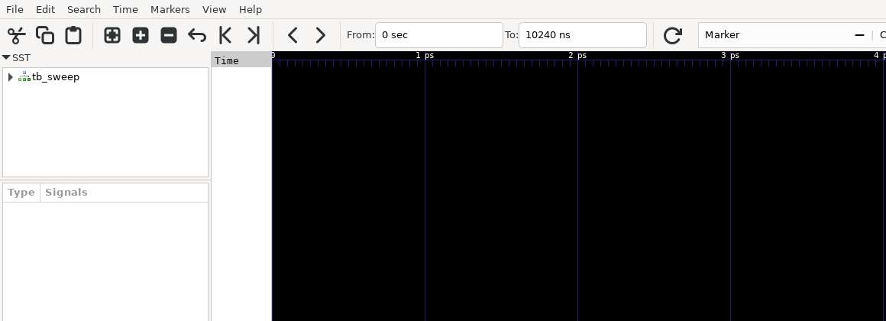
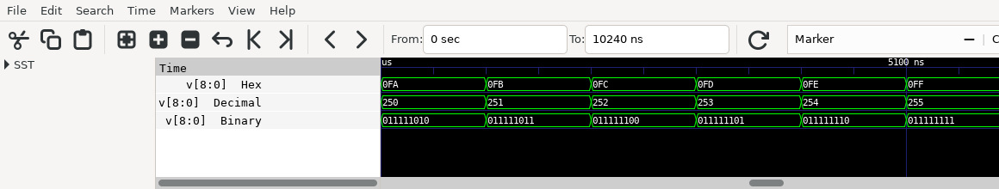

# Reading a waveform

This page is for looking things up, so keep it open beside the waveform viewer while you work.
[Waveforms](../guide/two-lines-make-the-waveform-appear.md) is the page that teaches the ideas,
and [Lab 03, Part 2](../labs/lab-03-the-lazy-testbench-overview.md) is where you put them into
practice.

## The three viewers

| | Where | Version | Takes its signal list from |
|---|---|---|---|
| GTKWave | workbench, noVNC desktop | `GTKWave Analyzer v4.0.0-prealpha (8ba24ab)` | a `.gtkw` save file |
| Surfer | workbench, noVNC desktop | `surfer 0.7.0 (git: v0.7.0)` | a `--command-file` of plain commands |
| EPWave | inside EDA Playground, in the browser | — | the checkbox **Open EPWave after run** |

All three read the same `.vcd` file and draw the same picture, and none of them shows you anything
until you tell it which signals you care about. Knowing that will save you more time than anything
else on this page.

## A fresh GTKWave window

```bash
gtkwave results/sweep.vcd
```



Nothing is wrong with the simulation: the file is about 57 KB and holds 55 signals, and the pane
is black only because you haven't added any of them to the view yet.

| What | Where | What it is |
|---|---|---|
| SST | top left | the design tree. `tb_sweep`, with a triangle to expand it, is the testbench, and everything else sits under it |
| Type / Signals | bottom left | the signals inside whatever you selected in SST. You drag them from here into the wave pane |
| the black pane | right | the waveform, which stays empty until you drag something into it |
| From: / To: | toolbar | the time range of the whole file, here `0 sec` to `10240 ns` |

Look at the ruler across the top of the black pane: it reads `1 ps`, `2 ps`, `3 ps`. GTKWave
opens fully zoomed in at time zero, on a run that is ten million picoseconds long, so even after
you add signals you'll see only flat lines until you zoom out.

> In a fresh GTKWave window, do `Time → Zoom → Zoom Best Fit` and add signals, in either order,
> before you conclude anything.

You can skip all of this by opening a save file along with the data file, and that's what every
`make wave` in this course does:

```bash
gtkwave results/sweep.vcd views/sweep.gtkw
```

## What the marks mean

| Mark | Meaning |
|---|---|
| a line along the top or the bottom | a 1-bit signal, high or low |
| a box with a number in it, pinching at each change | a multi-bit signal, and the number is its value over that stretch of time |
| red, usually reading `x` or `xx` | unknown: nothing has driven this signal yet |
| red and reading `z` | high impedance: nothing is driving it at all. You meet this in [Lab 04](../labs/lab-04-four-adders-in-a-row-overview.md), where a loop bound that is one too small leaves `sum[3]` and `cout` with no driver, and every one of the 512 answers comes back `Z` |
| a vertical line you can drag | the marker. Every value in the value column is read at the marker's time |
| the number after a name, e.g. `cin =1` | that signal's value at the marker, which GTKWave shows next to the name but which isn't part of it |

Red at time zero is normal, because every register starts out unknown and the first vector sets
it. In a purely combinational design like this course's adder, though, red after the first vector
is a real bug: either a signal has nothing driving it, or two things are driving it against each
other.

## Reading a bus

Here is the same bus at the same instant, written in three notations:



`0FA`, `250` and `011111010` are one value on the same nine wires, written three ways. When a bus
"changes to hex", nothing in the signal has changed; you've only changed how the viewer writes it
down.

To change the notation, select the trace and choose **Edit → Data Format →** followed by one of:

```
Hex   Decimal   Binary   Octal   ASCII   Time   Enum
```

In a `.gtkw` save file, the format is set by the `@` number on the line above the signal:

| In the save file | Shows as | This course uses it for |
|---|---|---|
| `@22` | Hex | buses: `a[3:0]`, `sum[3:0]`, `expected[4:0]` |
| `@24` | Decimal | when you want to read the arithmetic directly |
| `@28` | Binary | every 1-bit signal: `cin`, `cout`, `mismatch` |
| `@200` then a line containing only `-` | a blank spacer row | separating inputs from outputs |

The figure above came from
[`views/radix.gtkw`](https://github.com/uoftasic/dd102/blob/main/labs/guide-examples-proving-it/views/radix.gtkw):

```bash
cd labs/guide-examples-proving-it
make sweep                                  # if results/sweep.vcd is not there yet
gtkwave results/sweep.vcd views/radix.gtkw
```

> A save file can also give a trace a different display name, which is how that figure labels
> three copies of one signal: `+{v[8:0]  Hex}tb_sweep.v[8:0]`. Only the label on the screen
> changes; the signal itself is left alone.

## Finding the moment something went wrong

There are four steps. They work in every viewer, and you should take them in this order.

1. Get the time from the log rather than from the picture. Every testbench in this course prints
   it:

   ```
   TESTED 512
   ERRORS 256
   FIRST MISMATCH at 30 ns
   VERDICT FAIL
   ```

   Hunting for a failure by eye across 512 vectors can take an afternoon, and the log has already
   told you where it is.

2. Put your verdict in the waveform. `tb_sweep.sv` computes a signal called `mismatch` and dumps
   it like any other wire. It costs one line of testbench, and instead of knowing the failure is
   "somewhere in here" you get a trace that goes high exactly where the design broke.

3. Park the marker on that time. In GTKWave, type the time into the **Marker** box in the toolbar,
   or use `Time → Move To Time`. In a save file the marker time is the second field of the `*`
   line, so `*-14.4 30000 -1 …` means zoom −14.4 with the marker at 30000. That number is in the
   VCD's own units, which here are picoseconds, so it's 30 ns. In Surfer the same thing is
   `marker_set 1 30000`.

4. Read the value column rather than the shapes. With the marker parked, every name on the left
   carries its value at that instant. For the broken ripple adder the column reads `a[3:0] =0`,
   `b[3:0] =0`, `cin =1`, `sum[3:0] =0`, `cout =0`, `expected[4:0] =01`, `mismatch =1`, which
   spells out the failing case: 0 + 0 + 1 should be 1, and the adder said 0.

To step to the next disagreement after the first one, highlight `mismatch` and use
`Markers → Find Next Edge`.

## GTKWave menus

| Want to | Menu |
|---|---|
| see the whole run at once | `Time → Zoom → Zoom Best Fit` |
| zoom in / out one step | `Time → Zoom → Zoom In` / `Zoom Out` |
| undo a zoom | `Time → Zoom → Undo Zoom` |
| jump the marker to a time | `Time → Move To Time` |
| jump to the next change of the highlighted signal | `Markers → Find Next Edge` |
| leave a named marker behind | `Markers → Drop Named Marker` |
| change hex/decimal/binary | `Edit → Data Format → …` |
| insert a gap between groups of signals | `Edit → Insert Blank` |
| find a signal by name in a big design | `Search → Signal Search Regexp` |
| keep the layout you just built | `File → Write Save File As` |
| save the picture | `File → Grab To File` |

`File → Write Save File As` is the one people wish they had known about sooner. You build the view
once and write the save file, and from then on `gtkwave x.vcd x.gtkw` gives you the same view every
time. Every `views/*.gtkw` in this repo was made that way.

## Surfer command files

Surfer takes a plain-text command file instead of a save file:

```bash
surfer --command-file views/sweep.surf results/sweep.vcd
```

| Command | What it does |
|---|---|
| `scope_select tb_sweep` | make that module the current scope |
| `variable_add tb_sweep.mismatch` | add one signal to the view |
| `divider_add carry` | add a labelled separator row (the label is one word, and extra words are an error) |
| `marker_set 1 30000` | put marker number 1 at that time, in the file's own units |
| `show_marker_window` | open the marker readout panel |
| `variable_set_name_type Local` | show short names instead of full paths |
| `goto_start` / `goto_end` | jump to either end of the run |
| `zoom_fit` | fit the whole run in the window |

The command is `zoom_fit`. It's easy to write `zoom_to_fit` instead, because it reads better, but
there is no such command, and the way Surfer reacts to a command it doesn't know makes the mistake
easy to miss:

```
ERROR libsurfer::batch_commands: Error on batch commands line 12: InvalidParameter(
    "zoom_to_fit",
)
```

Surfer prints that and opens the window anyway. The error is one red line in a scroll of blue
`INFO` lines, and the window looks fine even though it isn't showing what your file asked for.
Surfer doesn't exit with a non-zero status either, so after you edit a `.surf` file, run `grep ERROR` on
the console output before you trust the window.

The blue `INFO` lines themselves are normal. `Looking for user decoders at
/headless/.config/surfer/decoders`, `Looking for user mapping translators at …` and `Watching file
… for changes` are Surfer describing its startup. They mention four or five paths that don't exist
on your machine, and none of that is a problem.

## Symptom → cause

| What you see | What it is |
|---|---|
| the wave pane is completely black | you haven't added any signals yet; the simulation didn't fail |
| signals added, but every line is flat | you are zoomed in at time 0, so use `Zoom Best Fit` |
| `Could not initialize GTK!  Is DISPLAY env var/xhost set?` | you ran GTKWave from a terminal with no desktop, and it needs the noVNC desktop |
| no `.vcd` file at all after a run | the testbench has no `$dumpfile`/`$dumpvars` |
| EDA Playground ran fine, but no waveform window appeared | pop-ups are blocked, or **Open EPWave after run** is unticked |
| a bus reads `xx` in red at t = 0 | normal, because nothing has driven it yet |
| a bus reads `x` in red after the first vector | a real bug, if the design is combinational |
| Surfer opened but ignored half your command file | a mistyped command, so look for the one red `ERROR` line |
| `$finish called at 10240000 (1ps)` | the testbench finishing normally, with the time reported in picoseconds |

## `ping` isn't installed

The workbench doesn't include `ping`. If a browser tool won't load and you try `ping` to find out
whether the network is the problem, you get `command not found`, which makes the container look
broken even though it's fine. Use `curl` instead, which is installed:

```bash
curl -sS -o /dev/null -w "%{http_code}\n" https://www.edaplayground.com/
```

```
200
```

[The browser tools](../reference/the-three-browser-tabs.md) says what to do with the answer.

## Summary

| | |
|---|---|
| an empty pane | means you haven't added any signals, never that nothing ran |
| a fresh GTKWave window | opens zoomed all the way in at t = 0, so do Zoom Best Fit first |
| a bus | is a box with a number in it, and you choose the notation |
| red | means unknown, which is fine at t = 0 and a bug afterwards |
| the value column | is a readout at the marker, not part of the signal name |
| finding a bug | dump a verdict signal, read the time from the log, and park the marker there |
| a view worth keeping | save it with `File → Write Save File As`, and commit the `.gtkw` |
| `zoom_fit` | is how Surfer spells it. `zoom_to_fit` fails with one easy-to-miss `ERROR` line, and the window still opens |
